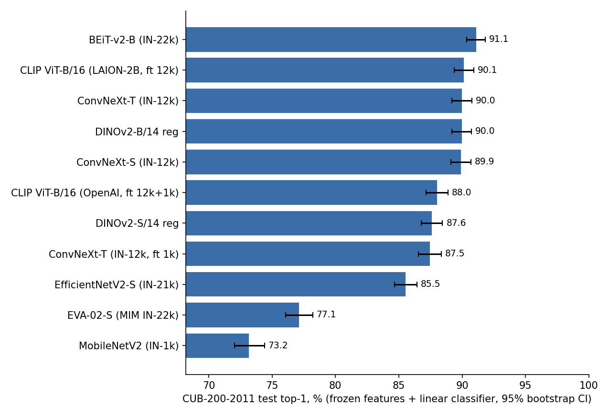
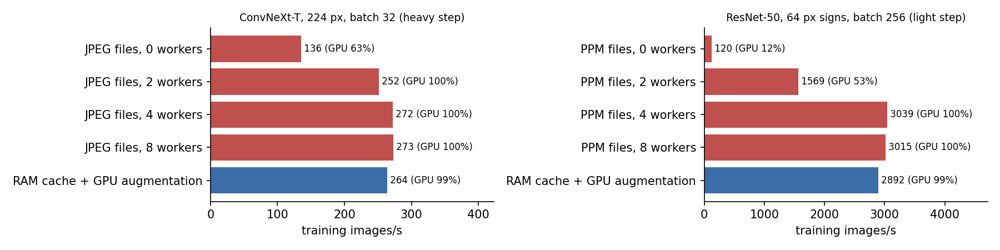
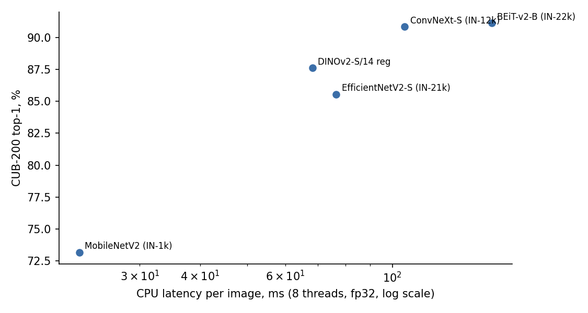
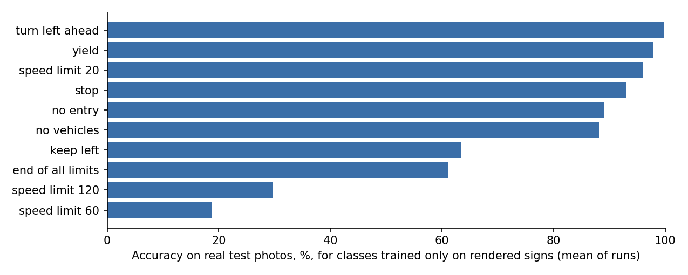
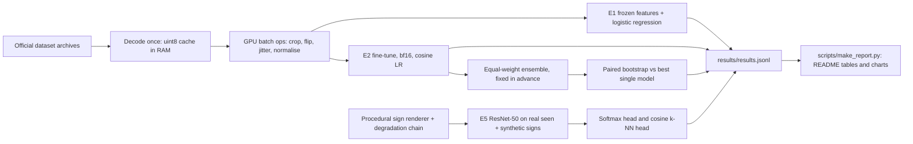

# Transfer Learning and Synthetic Data on One Consumer GPU

**Two computer-vision problems, solved and measured end to end on a single RTX 3060 (12 GB) under Windows: telling apart all 200 bird species of CUB-200-2011, and recognising traffic-sign classes that have zero real training images (GTSRB). An 11-backbone sweep, LP-FT fine-tuning that beats the textbook recipe, an ensemble whose gain is tested for significance, an input-pipeline study, a CPU-only deployment budget, and a procedural sign renderer that teaches a ResNet-50 classes it has never seen in a photo. Every results table in this README is generated from `results/results.jsonl`, and every accuracy comes with a bootstrap confidence interval.**


<!-- table:facts -->
| | |
|---|---|
| **What it is** | A reproducible computer-vision R&D harness: dataset readers, a uint8 RAM cache with GPU-side augmentation, an 11-backbone zoo, linear probes, LP-FT fine-tuning, a procedural traffic-sign renderer, bootstrap statistics, and a report generator |
| **Fine-grained result** | **91.7%** top-1 on all 200 CUB-200-2011 species (equal-weight ensemble of LP-FT ConvNeXt-S and BEiT-v2-B), a gain of +0.57 pp over the best single model with a paired 95% CI of +0.15 to +0.95 pp |
| **Zero real images** | Ten GTSRB classes never seen in a photo: **0% to 69.9%** with procedurally rendered signs and a k-NN head (mean of 3 runs), at a cost of 0.1 pp on the seen classes |
| **Fine-tuning** | The textbook recipe lost 0.93 pp to a frozen linear probe; LP-FT turned that into a gain of 0.95 pp (both CIs exclude zero) |
| **Input pipeline** | On a light workload, decoding in the main process left the GPU 88% idle; a RAM cache with GPU augmentation ran 24x faster with no worker processes |
| **Stack** | Python 3.12, PyTorch 2.10 (CUDA 13, bf16), timm 1.0, torchvision, OpenCV, NumPy, Pillow, matplotlib, pytest |
| **Hardware** | One RTX 3060 12 GB, Windows 11, 32 GB RAM; the full set of experiments runs in about 2 hours |
| **Tests** | 9 offline CPU tests, including a check that every percentage in the README tables exists in the result log |
<!-- /table:facts -->

## Results

### E1. Which pretrained backbone sees birds best? (frozen features, linear classifier)

Eleven public checkpoints, from a 2 M-parameter mobile CNN to 86 M-parameter ViTs pretrained with supervision, masked image modelling, self-distillation and CLIP. Each gets the same treatment: features of every image (centre crop and its mirror, averaged), a multinomial logistic regression whose L2 strength is chosen on a 20% stratified hold-out of the **train** split, then one score on the official 5,794-image test split.

<!-- table:e1 -->
| Backbone | Linear-probe top-1 | 95% CI | Feature dim | Extraction, img/s |
|---|---|---|---|---|
| BEiT-v2-B (IN-22k) | 91.1% | 90.4 to 91.8 | 768 | 410 |
| CLIP ViT-B/16 (LAION-2B, ft 12k) | 90.1% | 89.4 to 90.9 | 768 | 483 |
| ConvNeXt-T (IN-12k) | 90.0% | 89.2 to 90.8 | 768 | 879 |
| DINOv2-B/14 reg | 90.0% | 89.2 to 90.8 | 768 | 328 |
| ConvNeXt-S (IN-12k) | 89.9% | 89.1 to 90.7 | 768 | 520 |
| CLIP ViT-B/16 (OpenAI, ft 12k+1k) | 88.0% | 87.1 to 88.9 | 768 | 441 |
| DINOv2-S/14 reg | 87.6% | 86.8 to 88.4 | 384 | 816 |
| ConvNeXt-T (IN-12k, ft 1k) | 87.5% | 86.6 to 88.3 | 768 | 556 |
| EfficientNetV2-S (IN-21k) | 85.5% | 84.7 to 86.4 | 1280 | 558 |
| EVA-02-S (MIM IN-22k) | 77.1% | 76.1 to 78.2 | 384 | 662 |
| MobileNetV2 (IN-1k) | 73.2% | 72.0 to 74.4 | 1280 | 678 |
<!-- /table:e1 -->



### E2. Fine-tuning and an ensemble that has to prove itself

The best CNN and the best ViT by E1 **hold-out** accuracy (the test split played no part in the choice) are fine-tuned end to end with AdamW, one warm-up epoch then cosine decay, label smoothing 0.1, bf16 and all augmentation on the GPU. The first, textbook recipe (a fresh random head with a 10x learning rate) came out **below** the frozen linear probe of the same backbone: the large gradients of a random head reach the backbone in the first steps and damage features that were already good. LP-FT (Kumar et al., 2022) fixes the order: fit the head as a linear probe on frozen features first, then fine-tune everything from that starting point with one, lower learning rate. The ensemble averages the two LP-FT models with equal weights; its members were fixed before any test score was seen.

<!-- table:e2 -->
| Model | Recipe | Top-1 | 95% CI | Epochs | Training time | Train img/s | Peak GPU memory |
|---|---|---|---|---|---|---|---|
| BEiT-v2-B (IN-22k) | LP-FT | 91.1% | 90.4 to 91.9 | 10 | 8.9 min | 111 | 3.7 GB |
| ConvNeXt-S (IN-12k) | LP-FT | 90.8% | 90.1 to 91.6 | 10 | 7.0 min | 142 | 3.8 GB |
| ConvNeXt-S (IN-12k) | naive | 88.9% | 88.2 to 89.7 | 15 | 10.4 min | 143 | 3.8 GB |
| Ensemble: BEiT-v2-B (IN-22k) + ConvNeXt-S (IN-12k) | equal-weight average | 91.7% | 90.9 to 92.4 | | | | |
<!-- /table:e2 -->

<!-- table:e2cmp -->
| Backbone | Comparison (same test images) | Difference | Paired 95% CI | Verdict |
|---|---|---|---|---|
| BEiT-v2-B (IN-22k) | LP-FT vs linear probe | +0.00 pp | -0.52 to +0.47 pp | no measurable difference |
| ConvNeXt-S (IN-12k) | naive fine-tune vs linear probe | -0.93 pp | -1.67 to -0.21 pp | real loss |
| ConvNeXt-S (IN-12k) | LP-FT vs linear probe | +0.95 pp | +0.36 to +1.54 pp | real gain |
| ConvNeXt-S (IN-12k) | LP-FT vs naive fine-tune | +1.88 pp | +1.28 to +2.49 pp | real gain |
<!-- /table:e2cmp -->

<!-- table:e2gain -->
Ensemble gain over the best single model (BEiT-v2-B (IN-22k) fine-tuned): **+0.57 pp**, paired-bootstrap 95% CI +0.15 to +0.95 pp, share of resamples where it is not better: 0.003.
<!-- /table:e2gain -->

### E3. Where a training loop on Windows loses its time

The same training step fed four ways: JPEG or PPM files decoded by PIL in the main process, the same in 2, 4 or 8 DataLoader worker processes (Windows spawns each one and re-imports the stack), or the dataset decoded once into a uint8 array in RAM with crop, flip, colour jitter and normalisation done as batched tensor ops on the GPU (`vision/gpu.py`). Two workloads, because the answer depends on how heavy the GPU step is. GPU busy is sampled by `nvidia-smi` every 200 ms.

<!-- table:e3 -->
| Workload | Input pipeline | Training img/s | GPU busy | vs 0 workers |
|---|---|---|---|---|
| ConvNeXt-T, 224 px, batch 32 (heavy step) | JPEG files, 0 DataLoader workers | 136 | 63% | 1.0x |
| ConvNeXt-T, 224 px, batch 32 (heavy step) | JPEG files, 2 DataLoader workers | 252 | 100% | 1.9x |
| ConvNeXt-T, 224 px, batch 32 (heavy step) | JPEG files, 4 DataLoader workers | 272 | 100% | 2.0x |
| ConvNeXt-T, 224 px, batch 32 (heavy step) | JPEG files, 8 DataLoader workers | 273 | 100% | 2.0x |
| ConvNeXt-T, 224 px, batch 32 (heavy step) | RAM cache + GPU augmentation | 264 | 99% | 1.9x |
| ResNet-50, 64 px signs, batch 256 (light step) | PPM files, 0 DataLoader workers | 120 | 12% | 1.0x |
| ResNet-50, 64 px signs, batch 256 (light step) | PPM files, 2 DataLoader workers | 1569 | 53% | 13.0x |
| ResNet-50, 64 px signs, batch 256 (light step) | PPM files, 4 DataLoader workers | 3039 | 100% | 25.3x |
| ResNet-50, 64 px signs, batch 256 (light step) | PPM files, 8 DataLoader workers | 3015 | 100% | 25.1x |
| ResNet-50, 64 px signs, batch 256 (light step) | RAM cache + GPU augmentation | 2892 | 99% | 24.0x |
<!-- /table:e3 -->



With a heavy step the GPU is the limit and any loader with workers keeps up. With a light step, decoding in the main process starves the GPU: it sits idle most of the time. Four workers or the RAM cache both saturate it; the cache does it with no worker processes at all, which matters on Windows where every worker is a full copy of the Python process.

The first run of the E1 sweep extracted features about 13x slower than the final one. Turning on cuDNN autotuning and TF32 made the problem go away, but a controlled re-measurement in fresh processes shows autotuning is worth far less than that, so the honest conclusion is that the slow run was most likely competing with another GPU process; it was discarded and the sweep re-run. What autotuning and bf16 actually buy on this card:

<!-- table:e3b -->
| ConvNeXt-T forward, batch 64 | ms per batch | img/s |
|---|---|---|
| fp32, autotune off | 143 | 448 |
| fp32, autotune on (+TF32) | 107 | 600 |
| bf16, autotune off | 71 | 903 |
| bf16, autotune on (+TF32) | 69 | 930 |
<!-- /table:e3b -->

### E4. What it costs without a GPU

Deployment target: a CPU-only machine, fp32, 8 threads. Latency is the median of 50 single-image runs after warm-up; throughput is at batch 32. These runs shared the machine with other CPU work, so absolute times are pessimistic; the ordering and the ratios are the point.

<!-- table:e4 -->
| Model | Params | fp32 weights | CPU latency, 1 image | CPU throughput, batch 32 | Whole test split on CPU | Best CUB top-1 |
|---|---|---|---|---|---|---|
| MobileNetV2 (IN-1k) | 2.5 M | 10 MB | 22 ms | 67 img/s | 87 s | 73.2% (probe) |
| DINOv2-S/14 reg | 21.7 M | 83 MB | 68 ms | 19 img/s | 308 s | 87.6% (probe) |
| EfficientNetV2-S (IN-21k) | 20.4 M | 79 MB | 76 ms | 26 img/s | 225 s | 85.5% (probe) |
| ConvNeXt-S (IN-12k) | 49.6 M | 189 MB | 106 ms | 15 img/s | 387 s | 90.8% (fine-tuned) |
| BEiT-v2-B (IN-22k) | 85.9 M | 328 MB | 161 ms | 8 img/s | 717 s | 91.1% (fine-tuned) |
<!-- /table:e4 -->



### E5. Ten traffic-sign classes with zero real training images

Ten of GTSRB's 43 classes are removed from the real training data entirely: speed limits 20, 60 and 120, yield, stop, no vehicles, no entry, end of all limits, turn left ahead and keep left. The only way the network can learn them is from signs drawn procedurally from geometry (`vision/synth_signs.py`: red rings and German-style digits, octagons, triangles, blue discs with arrows) and pushed through a camera degradation chain: perspective, rotation, natural-photo backgrounds, exposure, colour cast, gamma, blur and motion blur, down-sampling to 18 to 56 px, JPEG artefacts, sensor noise. Scored on the full official test set of 12,630 real photos. Two of the held-out classes are mirror images of seen ones (turn left versus turn right, keep left versus keep right), so the network cannot pass by recognising the shape alone.

<!-- table:e5 -->
| Training data | Runs | Overall | Seen classes | Held-out classes (0 real images), mean ± SD over runs | Held-out 95% bootstrap CI, seed 0 |
|---|---|---|---|---|---|
| Real images of all 43 classes (upper bound) | 1 | 98.9% | 99.0% | 98.5% | 98.1 to 98.9 |
| Real images of the 33 seen classes only | 1 | 77.2% | 99.0% | 0.0% | 0.0 to 0.0 |
| + synthetic images of the 10 held-out classes | 3 | 89.5% | 99.0% | 56.0% ± 0.4 | 53.5 to 57.2 |
| + synthetic images of all 24 drawable classes | 3 | 91.6% | 98.9% | 65.9% ± 1.0 | 65.5 to 69.0 |
| same network, cosine k-NN head | 3 | 92.5% | 98.9% | 69.9% ± 2.1 | 71.2 to 74.5 |
<!-- /table:e5 -->

Per held-out class, best condition:

<!-- table:e5cls -->
| Held-out class | Accuracy (mean over runs) |
|---|---|
| turn left ahead | 99.7% |
| yield | 97.8% |
| speed limit 20 | 96.1% |
| stop | 93.1% |
| no entry | 89.0% |
| no vehicles | 88.1% |
| keep left | 63.3% |
| end of all limits | 61.1% |
| speed limit 120 | 29.6% |
| speed limit 60 | 18.8% |
<!-- /table:e5cls -->



## Findings

<!-- table:findings -->
1. **What a backbone was trained on matters more than its architecture.** The same ConvNeXt-T scores 90.0% on birds from its ImageNet-12k features and 87.5% after those were further fine-tuned on ImageNet-1k (non-overlapping CIs): the 1k fine-tune narrows the features toward 1,000 everyday classes. CLIP from LAION-2B beats CLIP from OpenAI data by 2.1 pp on the same ViT-B/16.
2. **Fine-tuning can make a good model worse.** A fresh random head with a 10x learning rate cost ConvNeXt-S 0.93 pp against its own linear probe. Fitting the head first (LP-FT) and fine-tuning with one, lower learning rate gave +0.95 pp over the probe and +1.88 pp over the naive recipe. For BEiT-v2-B, whose features were already the best in the sweep, fine-tuning moved nothing (+0.00 pp).
3. **The ensemble gain is small but real.** +0.57 pp with a paired CI that excludes zero; the members were fixed before scoring, so this is not a number picked after the fact.
4. **The input pipeline is only a bottleneck when the GPU step is light.** For ConvNeXt-T at 224 px, two workers already hit the GPU ceiling. For ResNet-50 on 64 px signs, the main process alone delivers 120 img/s with the GPU 12% busy, while 4 workers or the RAM cache reach 2,892 to 3,039 img/s with the GPU saturated.
5. **bf16 is the real speed lever, autotuning a small one.** On this card bf16 autocast doubles fp32 throughput; cuDNN autotuning with TF32 adds 1.34x in fp32 and about 3% under bf16.
6. **For a CPU deployment the knee is ConvNeXt-S.** It gives 90.8%, 0.3 pp below BEiT-v2-B, at two thirds of its latency and 58% of its weight size; MobileNetV2 is about 5x faster again but 17.7 pp less accurate on birds.
7. **Synthetic data has a shortcut problem, and fixing it is worth 10 pp.** Rendering only the held-out classes taught the network that "looks drawn" means "new class": 56.0% on them. Rendering every drawable class, seen ones too, removed that cue and lifted the held-out classes to 65.9%; a cosine k-NN head over the same embeddings reached 69.9%, while the seen classes stayed at 98.9%. A mirrored sign learned only from drawings (turn left ahead) is recognised at 99.7%; speed-limit digits are the weak spot (60 at 18.8%, 120 at 29.6%), because at 30 px their glyphs blur into the neighbouring limits.
<!-- /table:findings -->

## How it works



Methodology rules the code enforces:

- **One test look per configuration.** Hyper-parameters (the L2 strength, which models to fine-tune, the ensemble members) are chosen on the train split or fixed in advance; the official test split is only scored.
- **Noise is reported, not hidden.** Every accuracy has a 95% percentile bootstrap CI over test images; a claimed gain is a paired bootstrap on the same images.
- **Held-out means held-out.** Every real training image of the ten GTSRB classes is removed, not a sample of them; the score is on the official test set, which was recorded separately from the training tracks.
- **Numbers are generated, never typed.** `scripts/make_report.py` writes the tables from the result log, and a test fails if a percentage in this README is not in the log.

## Reproduce

```bash
pip install -r requirements.txt          # CUDA build of torch first, see pytorch.org
python scripts/get_data.py               # CUB-200-2011 (~1.1 GB) and GTSRB (~0.4 GB) into ./data
PY=python bash scripts/run_all.sh        # every experiment, about 2 h on an RTX 3060
python scripts/make_report.py            # README tables and docs/img charts from results/results.jsonl
python -m pytest -q tests                # offline, CPU
```

Single experiments: `python experiments/cub_linear_probe.py`, `cub_finetune.py --model convnext_small.in12k`, `cub_ensemble.py`, `throughput.py`, `cudnn_autotune.py`, `cpu_budget.py`, `gtsrb_unseen.py --conditions synth_all --seeds 0 1 2`. Set `VISION_DATA` to keep the datasets and caches elsewhere.

## Repository layout

```
vision/        datasets and uint8 cache, GPU augmentation, backbone zoo, sign renderer, statistics
experiments/   E1 to E5, each appends its records to results/results.jsonl
scripts/       data download, run-everything script, README and chart generator
results/       results.jsonl (every run, with environment), summary.json (aggregates across seeds)
tests/         offline CPU tests, including the README-numbers check
docs/img/      charts and renderer previews
```

## Limitations and honest scope

- **Pretraining overlap.** ImageNet-21k and ImageNet-12k contain bird classes, and some CUB test images are known to also appear in ImageNet. The CUB numbers measure transfer from these public checkpoints as they are, which is how they are used in practice, not learning from scratch.
- **One seed on CUB.** E1 and E2 are single runs; the bootstrap CIs cover test-set sampling noise, not training randomness. E5 repeats the synthetic-data conditions over three seeds; the k-NN head varies the most across seeds (SD 2.1 pp).
- **Uniform 224 px.** All backbones run at 224 px for a like-for-like comparison. EVA-02-S was pretrained at 336 px and loses accuracy from position-embedding interpolation at 224; its E1 number is not representative of the model at its native size.
- **The renderer covers geometry, not everything.** 24 of 43 GTSRB classes are drawable from primitives; pictogram signs (animals, pedestrians, cars) are not, so they cannot be held out with this method.
- **Hardware-specific timings.** Throughput and latency are for one Windows 11 machine with an RTX 3060 and an 8-thread CPU budget; the relative picture is the point, not the absolute numbers.

## License

Code: MIT. CUB-200-2011 and GTSRB are not redistributed here and keep their own terms of use; `scripts/get_data.py` fetches them from the official sources. Pretrained weights come from the timm and torchvision model hubs under their respective licenses.
